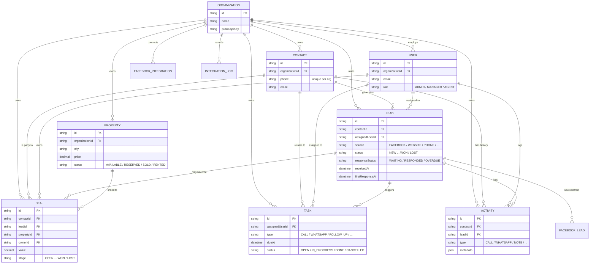

<div align="center">

# 🏠 ESTATEFLOW

### A real-estate CRM built around one number: **how fast you respond to a lead**

Capture leads from any source, route them to the right agent instantly, and know the
moment a lead goes cold — before your competitor calls back first.

*Built to run against your own PostgreSQL — no live demo, no hosted sample data. See [Running Locally](#-running-locally), it takes about 5 minutes.*

</div>

---

## 📋 Table of Contents

- [Overview](#-overview)
- [The Problem](#-the-problem)
- [Target Audience](#-target-audience)
- [Competitors & Differentiation](#-competitors--differentiation)
- [Key Features](#-key-features)
- [Data Model (ERD)](#-data-model-erd)
- [Tech Stack](#-tech-stack)
- [External Services & Integrations](#-external-services--integrations)
- [Running Locally](#-running-locally)
- [Demo Accounts](#-demo-accounts)
- [Project Status](#-project-status)

---

## 📖 Overview

ESTATEFLOW is a multi-tenant CRM for real-estate agency offices — leads, contacts,
properties, deals and tasks in one place, in Hebrew, right-to-left. Every office's data
is fully isolated from every other office on the same install.

The product is organized around **Speed to Lead**: the moment a lead arrives, the clock
starts. The system auto-assigns an agent, creates a follow-up task, and tracks — in
real time — whether that lead gets a genuine response (a logged call, an outbound
WhatsApp, an outbound email) before the SLA window closes. If it doesn't, the lead is
flagged overdue automatically, with no one having to notice it manually.

Nothing in the product fakes success it hasn't verified: the Automations page reports
real integration state (connected / not configured / last result), not an assumption
that a button click worked.

## 🎯 The Problem

Industry studies on inbound sales leads consistently point to the same pattern: the
odds of actually qualifying a lead drop sharply the longer an agent takes to respond,
and a large share of leads never get followed up at all once they slip past the first
hour. Small-to-mid agency offices mostly run this process by memory — a shared inbox,
a WhatsApp group, a spreadsheet — which works until lead volume grows past what one
person can watch.

ESTATEFLOW replaces "did someone call them back?" with a number everyone can see:
waiting / responded / overdue, measured automatically from real timestamps.

## 👥 Target Audience

- **Core audience:** small-to-mid real-estate agency offices (a few agents to a few
  dozen) that take in leads from multiple channels — website, Facebook, phone,
  referrals — and need those leads routed and tracked without manual triage.
- **Secondary audience:** office managers/admins who need a single, honest view of
  pipeline health, agent response times and deal flow, without chasing status updates.

The typical user is an agent who logs a call right after taking it, or a manager who
opens the dashboard each morning to see what's waiting and what's overdue.

## 🆚 Competitors & Differentiation

| Alternative | Its Weakness | ESTATEFLOW's Edge |
|---|---|---|
| **General CRMs (Salesforce, HubSpot, etc.)** | Built for generic sales, not real-estate workflows; heavy setup, pricing and complexity for a small office | Purpose-built entities (Lead, Property, Deal) and a Speed-to-Lead model out of the box |
| **Spreadsheet / shared inbox / WhatsApp group** | No automation, no deduplication, no idea which lead is overdue until a client complains | Automatic contact dedup, round-robin assignment, and a live overdue flag — nothing relies on someone remembering to check |
| **"Dumb" lead forms with no CRM behind them** | A lead arrives, lands in an inbox, and whether anyone followed up is invisible | Every lead is timestamped end-to-end: received → assigned → first response → closed |

**Core differentiation:** most tools tell you *a lead came in*. ESTATEFLOW tells you
*whether anyone has actually responded, and how fast* — and shows that honestly, with
real automation status instead of assumed success.

---

## ⚡ Key Features

| Feature | Description |
|---|---|
| 🔐 **Secure Auth & Multi-Tenant** | JWT-based login; every office's data is fully isolated from every other office |
| 📥 **Smart Lead Intake** | Public web-form API, Facebook Lead Ads webhook, or manual entry — all routed through the same pipeline |
| 🧑‍🤝‍🧑 **No Duplicate Contacts** | Phone numbers are normalized and matched before a new contact is ever created |
| ⚡ **Speed-to-Lead Tracking** | Live response-time clock per lead; automatic `WAITING → RESPONDED / OVERDUE` based on real SLA timestamps |
| 🤖 **Automatic Agent Assignment** | Round-robin distribution across active agents, with manual override |
| 📋 **Auto Follow-Up Tasks** | Every new lead gets a due-dated follow-up task tied to the SLA window |
| 🗂️ **Leads & Contacts** | Filterable tables, a detail side panel, and a full activity timeline per lead/contact |
| 🏘️ **Property Listings** | Manage inventory for sale or rent, grid or table view |
| 💼 **Deals Pipeline** | Kanban board with drag-and-drop stage changes; closing a deal syncs its linked lead |
| ✅ **Tasks & Calendar** | Today / overdue / upcoming / completed views, plus a month calendar |
| 🔌 **Honest Automations Center** | Real connection status for n8n, WhatsApp and Facebook — reports "not connected" rather than faking a result |
| 📊 **Dashboard & Reports** | Real-time KPIs, response-time analytics, and lead-by-source/status/agent breakdowns |
| 🌐 **Hebrew RTL** | Full right-to-left interface, not a translated afterthought |

---

## 🗄️ Data Model (ERD)

PostgreSQL via Prisma. Every business table carries an `organizationId` so tenant
isolation is enforced at the query layer, not just the UI.



---

## 🧰 Tech Stack

| Layer | Technology |
|---|---|
| **Backend** | Node.js + Express |
| **Database** | PostgreSQL |
| **ORM** | Prisma |
| **Validation** | Zod |
| **Auth** | JWT + bcrypt |
| **Backend Tests** | Vitest + Supertest |
| **Frontend** | React + Vite |
| **Styling** | Tailwind CSS v4 |
| **Server State** | TanStack Query |
| **Forms** | React Hook Form + Zod |
| **Charts** | Recharts |
| **Icons** | Lucide React |
| **Routing** | React Router |

---

## 🔌 External Services & Integrations

| Service | Type | Purpose | Status without credentials |
|---|---|---|---|
| **n8n** | Automation webhook | Receives `lead.created` / `lead.responded` / `lead.overdue` events to trigger external workflows | Dispatch is skipped and logged — lead creation never fails because of it |
| **WhatsApp Cloud API** | Messaging | Sends automated messages to leads/clients | Falls back to a logged mock provider — no message is silently dropped or faked as sent |
| **Facebook Lead Ads** | Lead source | Receives leads directly from Facebook ad campaigns via webhook | A `/simulate` dev endpoint reproduces the full pipeline without a live Meta app |

> **🔒 Security:** every credential (DB, JWT secret, API keys, integration tokens) is
> read from environment variables and documented in `.env.example` — nothing sensitive
> is hardcoded or committed. Tenant data access is scoped by `organizationId` at the
> query layer, not just hidden in the UI.

Every real attempt to call n8n or WhatsApp is recorded in an `IntegrationLog` table, so
the in-app Automations page always reflects what actually happened — never an assumed
success.

---

## 🚀 Running Locally

```bash
# 1. Backend
cd backend
npm install
cp .env.example .env         # fill in DATABASE_URL and the secrets
npm run db:up                 # optional: local PostgreSQL, no Docker needed
npm run db:migrate
npm run db:seed
npm run dev                   # http://localhost:3000

# 2. Frontend (new terminal)
cd frontend
npm install
cp .env.example .env
npm run dev                   # http://localhost:5173
```

Full setup details, environment variables, and the complete API reference live in the
two sub-project READMEs:

- 📘 [`backend/README.md`](backend/README.md) — architecture, data model, every
  endpoint, integration setup, tests
- 📗 [`frontend/README.md`](frontend/README.md) — architecture, pages, and the
  data-honesty rules the UI follows

## 👤 Demo Accounts

Seeded by `npm run db:seed` — all share the password **`Password123!`**:

| Email | Role |
|---|---|
| `admin@demoagency.example.com` | Admin — full access, team management |
| `manager@demoagency.example.com` | Manager — organization-wide visibility |
| `agent1@demoagency.example.com` | Agent — scoped to their own leads/deals/tasks |
| `agent2@demoagency.example.com` | Agent — scoped to their own leads/deals/tasks |

The seed also creates 10 contacts, 10 leads in a spread of response states (waiting,
overdue, responded, won, lost), 5 properties, 11 tasks and 4 deals — enough to see every
screen populated with real data immediately.

## ✅ Project Status

- **Backend:** 35 automated tests passing (Vitest + Supertest against a real Postgres
  test database) — auth, multi-tenant isolation, the full lead pipeline, Speed-to-Lead
  logic, and RBAC on destructive actions.
- **Frontend:** production build is clean; verified end-to-end in a real browser
  (login → live lead creation → auto-assignment → response tracking) with zero console
  or network errors.
- **Known limitations:** no file/image upload yet (property cards use a neutral
  placeholder); reporting aggregates are capped at the API's page size, flagged in the
  UI when a result set is truncated. Details in the sub-READMEs.

<div align="center">

⭐ *ESTATEFLOW — because "we'll call them back" is not a process.*

</div>
